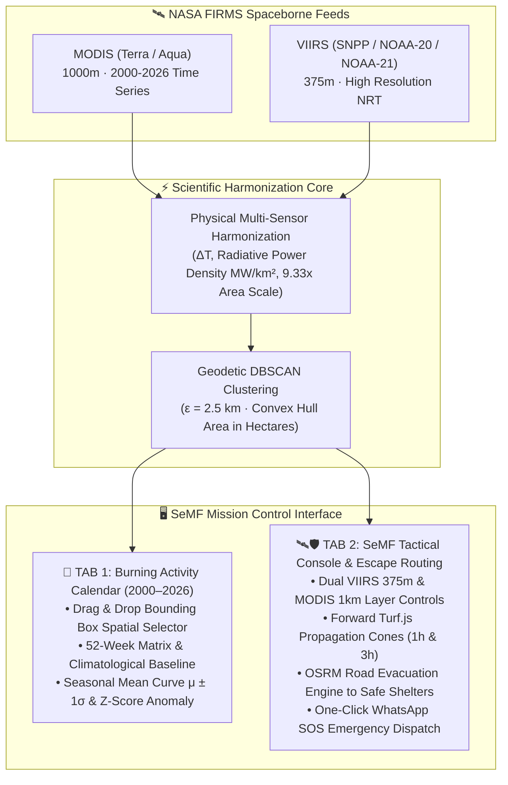

# 🔥 SeMF / AURA-FIRE — Multi-Sensor Satellite Harmonization & Wildfire Tactical Intelligence
**NASA Space Apps Challenge 2026** — *Challenge Track: MODIS and VIIRS Hot Spots*

[](https://hackaton-nasa-k2cr.vercel.app/)
[](https://www.spaceappschallenge.org/)
[](https://firms.modaps.eosdis.nasa.gov/)
[](https://www.python.org/)
[](docker-compose.yml)
[](tests/)
[](LICENSE)

---

### 👥 Team: **Maxwell Crew**
**Members:**  
- **Juan Ibañez**  
- **Marcos Moleker**  
- **Nicolas Calderon**  
- **Joel Figueroa**  
- **Juan Nicolas Muñoz**  
- **Vale Gregorio**  

---

### 🌐 OFFICIAL LIVE WEB ACCESS (ZERO INSTALLATION REQUIRED)
> ### 🚀 [**https://hackaton-nasa-k2cr.vercel.app/**](https://hackaton-nasa-k2cr.vercel.app/)
> *Instant access on any desktop or mobile device. Evaluators can explore live maps, routing, simulation, and 26-year historical analytics with zero installation.*

---

## 📌 1. Project Overview

**SeMF / AURA-FIRE** (*Automated Unified Radiative Analytics for Fire Intercomparison & Resilient Evacuation / Fire Evaluation and Monitoring System*) is an aerospace-grade scientific and operational intelligence platform designed to bridge the gap between spaceborne Earth observation data and frontline wildfire emergency response.

Our system tackles the severe physical and spatial resolution disparities between NASA FIRMS sensors — **MODIS** (Terra/Aqua at $1000\,\text{m}$ resolution) and **VIIRS** (Suomi-NPP / NOAA-20 / NOAA-21 at $375\,\text{m}$ resolution) — unifying a continuous **26-year historical satellite time series (2000–2026)** and a high-readiness **Tactical Mission Control Console** featuring geodetic clustering, predictive Turf.js propagation cones, and real-time OSRM road evacuation routing for the mountain ranges of **Córdoba and San Luis, Argentina**.

---

## 🎛️ 2. Core Platform Modules



### 📅 Module 1: Historical Burn Risk — 26-Year Calendar (2000–2026)
- **26-Year Climatological Baseline:** Uninterrupted integration of NASA FIRMS MODIS (2000–2026) and VIIRS (2012–2026) historical records, filtered to eliminate sensor overlap and duplicate counts.
- **Interactive Spatial Bounding Box:** Freeform drag-and-drop spatial selection tool enabling users to draw a customized bounding box anywhere across Córdoba and San Luis to calculate immediate historical risk statistics.
- **52-Week Risk Matrix & Seasonal Envelope:** Comprehensive breakdown of fire frequency per calendar week and month, overlaying a 26-year seasonal expectation curve ($\mu \pm 1\sigma$) with localized Z-Score anomaly alerts.

### 🛰️🛡️ Module 2: SeMF Tactical Console & Emergency Escape System
- **Multi-Sensor Satellite Fusion:** Synchronized display of high-resolution VIIRS ($375\,\text{m}$) and MODIS ($1\,\text{km}$) thermal pixels color-coded by Fire Radiative Power (FRP in MW).
- **Fire Front Kinematics (Haversine DBSCAN):** Automated grouping of discrete detections into cohesive fire fronts, computing convex hull surface area (hectares), forward velocity ($\text{km/h}$), and heading azimutal bearings.
- **Turf.js Operational Propagation Cones:** Dynamic 1-hour and 3-hour projected advance cones incorporating live local wind vectors and relative humidity from Open-Meteo.
- **Safe Road Evacuation Engine (OSRM):** Real-time highway and road route calculation connecting user coordinates to the nearest official civil defense shelter or fire department station, avoiding active fire perimeters and calculating travel distance (km) and ETA (minutes).
- **Instant SOS Dispatch:** Single-click emergency trigger compiling exact GPS coordinates, nearest active fire front data, and shelter destination into a preformatted rescue message sent via WhatsApp.

---

## 🔬 3. Physical & Scientific Harmonization

| Physical Parameter | MODIS (Terra / Aqua) | VIIRS (NOAA-20 / SNPP) | Scientific Challenge | Maxwell Crew Solution |
| :--- | :--- | :--- | :--- | :--- |
| **Spatial Resolution** | $1000\text{ m} \times 1000\text{ m}$ ($1.0\text{ km}^2$) | $375\text{ m} \times 375\text{ m}$ ($\approx 0.14\text{ km}^2$) | Incomparable raw pixel footprint areas | Radiative Power Density: $\text{MW/km}^2 = \frac{\text{FRP}}{A_{\text{pixel}}}$. Empirical scale factor ratio: $9.33\times$. |
| **Infrared Channels** | `brightness` ($T_{21/22}$) & `bright_t31` ($T_{31}$) | `bright_ti4` ($T_{I4}$) & `bright_ti5` ($T_{I5}$) | Divergent column schemas across NASA APIs | Unified lossless mapping into $\text{Ch}_4$ ($\sim 4\,\mu\text{m}$) and $\text{Ch}_5$ ($\sim 11\,\mu\text{m}$). Thermal differential calculation: $\Delta T = T_4 - T_5$. |
| **Confidence Scale** | Continuous percentage ($0\text{–}100\%$) | Discrete categorical (`'l'`, `'n'`, `'h'`) | Incompatible statistical data types | Normalized continuous score ($0.0\text{–}1.0$) and standardized categorical classification (`Low`, `Nominal`, `High`). |
| **Spatial Clustering** | Discrete isolated hot spots | Dense point swarms | Lack of perimeter and front directionality | Geodetic Haversine DBSCAN ($R = 6371\text{ km}$, $\varepsilon = 2.5\text{ km}$) + convex hull geometry and centroid heading calculation. |

---

## 💻 4. Execution Modes

### Mode A: Instant Cloud Access (Recommended for Evaluators)
Simply open: **[https://hackaton-nasa-k2cr.vercel.app/](https://hackaton-nasa-k2cr.vercel.app/)**  
Zero installation, zero dependencies, responsive across mobile and desktop.

### Mode B: Local Containerized Deployment (Docker)
```bash
# 1. Clone the repository
git clone https://github.com/Fjoel00/HackatonNASA.git
cd HackatonNASA

# 2. Build and launch the container
docker compose up --build
```
Navigate to **http://localhost:8080** in your web browser.

### Mode C: Python Direct Execution & Test Suite
```bash
# 1. Install dependencies
pip install -r requirements.txt

# 2. Run unit test suite (8/8 automated tests)
python -m unittest discover tests

# 3. Compile the standalone portal
python generar_app_tactica.py

# 4. Start the local server
python app_server.py
```

---

## 📁 5. Repository Structure

```text
HackatonNASA/
├── docs/
│   └── INFORME_EQUIPO_Y_PRESENTACION_MVP.md   # 📑 Official Master Report: Pitch Guide & 99.0/100 Evaluation
├── data/
│   └── raw/                                   # Local cache & NASA FIRMS 2000-2026 historical archives
├── output/
│   ├── index.html                             # 📱 Official SeMF Standalone Web Portal (13.8 MB, 100% self-contained)
│   ├── app_tactica_mobile.html                # Consolidated Mobile-First Tactical Interface
│   ├── dashboard_data.json                    # Active NRT detections, DBSCAN clusters & kinematics
│   ├── historico_riesgo_grid.json             # 26-year historical risk grid for the seasonal calendar
│   ├── puntos_anuales.json                    # Annual thermal anomaly distribution dataset
│   ├── analisis_estadistico_sensores.png      # Comparative sensor distribution and FRP plots
│   ├── focos_calor_normalizados.csv           # Harmonized tabular fire detection database
│   └── perimetros_incendios.geojson           # Standard OGC GeoJSON polygons for QGIS and ArcGIS
├── tests/
│   └── test_pipeline.py                       # 🧪 Automated unit test suite (8/8 passing)
├── app_server.py                              # Local HTTP server with on-demand pipeline trigger
├── config.yaml                                # Geographic bounding box & satellite sensor parameters
├── docker-compose.yml & Dockerfile            # Production-ready Docker configuration
├── docker-entrypoint.sh                       # Automated startup and cache initialization script
├── generar_app_tactica.py                     # Autonomous compiler generating the interactive portal
├── pipeline_incendios_nasa.py                 # Core scientific harmonization & DBSCAN clustering engine
├── procesar_historico_firms.py                # 2000-2026 MODIS/VIIRS historical time series processor
├── requirements.txt                           # Python package dependencies
├── vercel.json & .vercelignore                # Static deployment configuration for Vercel CDN
└── README.md                                  # Official project documentation
```

---

## 👥 6. Team: Maxwell Crew

| Member | Role & Key Contributions |
| :--- | :--- |
| **Joel Figueroa** | Lead Software Architecture, Web Application Development, Vercel Deployment & System Integration |
| **Juan Ibañez** | Scientific Data Analysis, Sensor Footprint Calculations & Statistical Modeling |
| **Marcos Moleker** | Satellite Data Ingestion, FIRMS API Integration & Historical Time Series Harmonization |
| **Nicolas Calderon** | Geospatial Engine, Geodetic Haversine DBSCAN Clustering & Kinematic Algorithms |
| **Juan Nicolas Muñoz** | UI/UX Tactical Design, Interactive Leaflet Mapping & Turf.js Propagation Cones |
| **Vale Gregorio** | Emergency Routing Systems, OSRM Road Evacuation Logic & Disaster Preparedness Documentation |

---

## ⚖️ 7. License & Acknowledgments

This project is developed for the **NASA Space Apps Challenge 2026** under the [MIT License](LICENSE).  
We acknowledge the use of data and imagery from LANCE FIRMS operated by the NASA Goddard Space Flight Center / Earth Science Data and Information System (ESDIS) project.
