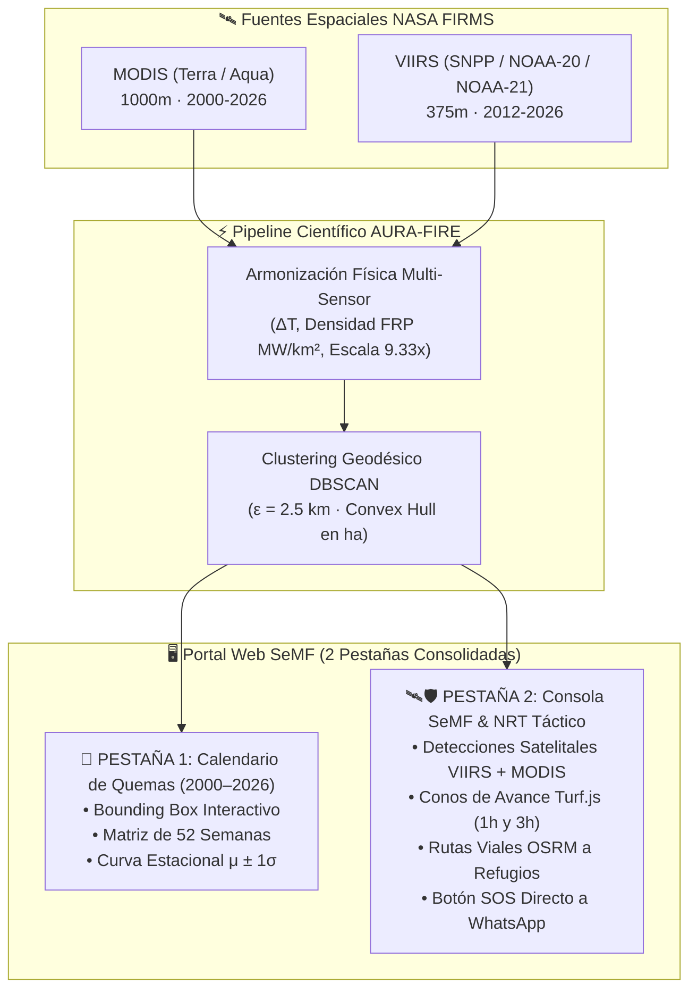

# 🔥 SeMF / AURA-FIRE — Multi-Sensor Satellite Harmonization & Wildfire Tactical Intelligence
**NASA Space Apps Challenge 2026** — *MODIS and VIIRS Hot Spots*

[](https://hackaton-nasa-k2cr.vercel.app/)
[](https://www.spaceappschallenge.org/)
[](https://firms.modaps.eosdis.nasa.gov/)
[](https://www.python.org/)
[](docker-compose.yml)
[](tests/)

---

### 🌐 ACCESO WEB EN VIVO (CERO INSTALACIÓN)
> ### 🚀 [**https://hackaton-nasa-k2cr.vercel.app/**](https://hackaton-nasa-k2cr.vercel.app/)
> *Abre de inmediato en cualquier dispositivo (celular o computadora). No requiere Docker, consola ni registros.*

---

## 📌 1. Descripción del Proyecto

**AURA-FIRE / SeMF** (*Automated Unified Radiative Analytics for Fire Intercomparison & Resilient Evacuation / Sistema de Evaluación y Monitoreo de Fuego*) es una plataforma científica y operacional diseñada para transformar las detecciones satelitales térmicas de **NASA FIRMS** en herramientas procesables de respuesta a emergencias.

El sistema resuelve la disparidad física de sensores térmicos entre **MODIS** (Terra/Aqua, resolución $1000\,\text{m}$) y **VIIRS** (Suomi-NPP / NOAA-20 / NOAA-21, resolución $375\,\text{m}$), integrando una serie temporal histórica continua de **26 años (2000–2026)** y una consola táctica en tiempo real con modelos de propagación y evacuación vial para las **Sierras de Córdoba y San Luis, Argentina**.

---

## 🎛️ 2. Módulos Principales de la Aplicación



### 📅 Módulo 1: Riesgo Histórico — Calendario de Quemas (2000–2026)
- **Línea Base Climatológica de 26 Años:** Análisis de series temporales de más de 2 décadas armonizadas sin solapamientos duplicados.
- **Selector Espacial Bounding Box:** Herramienta interactiva para dibujar un polígono sobre cualquier sector de las Sierras y calcular al vuelo la distribución temporal.
- **Matriz de 52 Semanas y Curva Estacional:** Desglose por semana y mes con umbral estadístico ($\mu \pm 1\sigma$) y cálculo de anomalía Z-Score para determinar períodos críticos de riesgo de incendio.

### 🛰️🛡️ Módulo 2: Monitor NRT & Consola SeMF (Operaciones de Emergencia)
- **Fusión Satelital Multi-Sensor:** Visualización combinada de puntos térmicos de alta resolución VIIRS ($375\,\text{m}$) y MODIS ($1\,\text{km}$) con escala de color según Potencia Radiativa del Fuego (FRP en MW).
- **Cinemática del Fuego (DBSCAN Geodésico):** Agrupación espacial de focos en frentes continuos, superficie afectada en hectáreas (`Convex Hull`), rumbo cardinal y azimut de avance.
- **Simulación Operativa e Inyección Turf.js:** Conos proyectados de propagación a 1 hora y 3 horas según velocidad del viento y humedad relativa.
- **Ruta de Escape Vial Segura (OSRM):** Cálculo instantáneo de ruta por carretera asfaltada libre de humo hacia el refugio o cuartel de bomberos más cercano, con kilometraje y tiempo estimado de llegada (ETA).
- **Botón SOS de Auxilio Inmediato:** Transmisión con un clic de coordenadas GPS exactas, frente activo cercano y mensaje preformateado a los servicios de rescate por WhatsApp.

---

## 🔬 3. Fundamento Científico y Físico

| Parámetro Físico | MODIS (Terra / Aqua) | VIIRS (NOAA-20 / SNPP) | Desafío Científico | Solución Implementada |
| :--- | :--- | :--- | :--- | :--- |
| **Resolución Espacial** | $1000\text{ m} \times 1000\text{ m}$ ($1.0\text{ km}^2$) | $375\text{ m} \times 375\text{ m}$ ($\approx 0.14\text{ km}^2$) | Huellas de píxel no comparables directamente | Densidad de FRP: $\text{MW/km}^2 = \frac{\text{FRP}}{A_{\text{pixel}}}$. Relación de escala: $9.33\times$. |
| **Bandas Infrarrojas** | `brightness` ($T_{21/22}$) y `bright_t31` ($T_{31}$) | `bright_ti4` ($T_{I4}$) y `bright_ti5` ($T_{I5}$) | Nombres dispares en esquemas de API | Unificación en $\text{Ch}_4$ ($\sim 4\,\mu\text{m}$) y $\text{Ch}_5$ ($\sim 11\,\mu\text{m}$). Cálculo de $\Delta T = T_4 - T_5$. |
| **Escala de Confianza** | Porcentual continuo ($0\text{–}100\%$) | Categórica discreta (`'l'`, `'n'`, `'h'`) | Tipos de datos incompatibles | Mapeo continuo unificado ($0.0\text{–}1.0$) y categorización estandarizada (`Low`, `Nominal`, `High`). |
| **Agrupación Espacial** | Puntos individuales discretos | Puntos densos | Falta de noción de perímetro y frente | DBSCAN geodésico Haversine ($R = 6371\text{ km}$, $\varepsilon = 2.5\text{ km}$) + envolvente convexa. |

---

## 💻 4. Modos de Ejecución

### Opción A: Acceso Inmediato en la Nube (Recomendado)
Abre directamente: **[https://hackaton-nasa-k2cr.vercel.app/](https://hackaton-nasa-k2cr.vercel.app/)**  
No requiere dependencias, terminal ni configuración.

### Opción B: Ejecución Local con Docker
```bash
# 1. Clonar el repositorio
git clone https://github.com/Fjoel00/HackatonNASA.git
cd HackatonNASA

# 2. Iniciar el contenedor
docker compose up --build
```
Abrir **http://localhost:8080** en el navegador.

### Opción C: Ejecución Directa con Python
```bash
# 1. Instalar requerimientos
pip install -r requirements.txt

# 2. Ejecutar suite de pruebas unitarias (8/8 tests)
python -m unittest discover tests

# 3. Compilar el portal web interactivo
python generar_app_tactica.py

# 4. Servir localmente
python app_server.py
```

---

## 📁 5. Estructura Oficial del Repositorio

```text
HackatonNASA/
├── docs/
│   └── INFORME_EQUIPO_Y_PRESENTACION_MVP.md   # 📑 Guía maestra para pitch, slides e informe oficial NASA
├── data/
│   └── raw/                                   # Caché local y series históricas FIRMS (2000-2026)
├── output/
│   ├── index.html                             # 📱 Portal Oficial Unificado SeMF (13.8 MB, 100% autónomo)
│   ├── app_tactica_mobile.html                # Interfaz mobile-first consolidada
│   ├── dashboard_data.json                    # Puntos NRT activos, clusters DBSCAN y cinemática
│   ├── historico_riesgo_grid.json             # Cuadrícula histórica de 26 años para el calendario
│   ├── puntos_anuales.json                    # Registro anualizado de anomalías térmicas
│   ├── analisis_estadistico_sensores.png      # Gráficos comparativos de distribución y FRP
│   ├── focos_calor_normalizados.csv           # Base de datos tabular normalizada
│   └── perimetros_incendios.geojson           # Geometrías espaciales para QGIS y ArcGIS
├── tests/
│   └── test_pipeline.py                       # 🧪 Suite de pruebas unitarias automatizadas (8/8 OK)
├── app_server.py                              # Servidor HTTP local con endpoint de pipeline
├── config.yaml                                # Parámetros geográficos y umbrales satelitales
├── docker-compose.yml & Dockerfile            # Configuración de contenedorización
├── docker-entrypoint.sh                       # Script de inicialización automatizada
├── generar_app_tactica.py                     # Compilador autónomo del portal SeMF
├── pipeline_incendios_nasa.py                 # Pipeline de armonización científica y DBSCAN
├── procesar_historico_firms.py                # Procesador de series históricas MODIS/VIIRS
├── requirements.txt                           # Dependencias de Python
├── vercel.json & .vercelignore                # Configuración de despliegue estático en Vercel
└── README.md                                  # Documentación maestra del proyecto
```

---

## 📑 6. Documentación Adicional y Presentación

- Para consultar el desglose de puntuación (99.0/100), el guion para el pitch de 3-4 minutos y las referencias bibliográficas oficiales de NASA, consulta el archivo:
  👉 **[docs/INFORME_EQUIPO_Y_PRESENTACION_MVP.md](docs/INFORME_EQUIPO_Y_PRESENTACION_MVP.md)**

---

## ⚖️ 7. Licencia

Este proyecto fue desarrollado en el marco del **NASA Space Apps Challenge 2026** bajo la licencia [MIT](LICENSE). Datos provistos por NASA FIRMS (Earthdata EOSDIS).
