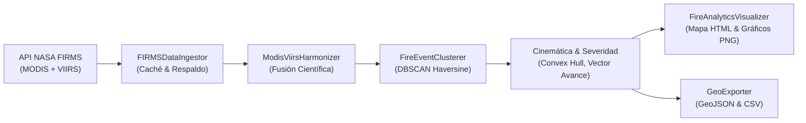

# 🔥 NASA Space Apps Challenge - MODIS & VIIRS Hot Spots Fusion & Analytics

[](https://www.spaceappschallenge.org/)
[](https://www.python.org/)
[](LICENSE)
[](https://firms.modaps.eosdis.nasa.gov/)

Sistema integral de **armonización científica multi-sensor**, **reconstrucción espaciotemporal de frentes de incendio (DBSCAN Geodésico)** y **visualización geoespacial interactiva** para anomalías térmicas y puntos calientes satelitales de los instrumentos **MODIS** (Terra/Aqua) y **VIIRS** (Suomi-NPP / NOAA-20 / NOAA-21) de NASA FIRMS.

---

## 📌 1. El Problema Científico

El sistema **NASA FIRMS** distribuye datos en tiempo casi real (NRT) de dos familias de sensores térmicos con características físicas dispares:

| Parámetro | MODIS (Terra / Aqua) | VIIRS (NOAA-20 / SNPP) | Desafío de Integración | Solución en Nuestro Pipeline |
| :--- | :--- | :--- | :--- | :--- |
| **Resolución Espacial** | $1000\text{ m} \times 1000\text{ m}$ ($1\text{ km}^2$) | $375\text{ m} \times 375\text{ m}$ ($\approx 0.14\text{ km}^2$) | Escala y huella de píxel no comparables | Estimación dinámica de huella (`scan × track`) y densidad de FRP ($\text{MW/km}^2$) |
| **Canales Térmicos** | `brightness` ($T_{21/22}$) y `bright_t31` ($T_{31}$) | `bright_ti4` ($T_{I4}$) y `bright_ti5` ($T_{I5}$) | Discrepancia de nombres de columnas en la API | Unificación sin pérdida en `temp_ch4_k`, `temp_ch5_k` y cálculo del diferencial $\Delta T$ |
| **Escala de Confianza** | Porcentaje numérico ($0\text{–}100\%$) | Categórico (`'l'`, `'n'`, `'h'`) | Incompatibilidad de tipos | Mapeo continuo ($0.0\text{–}1.0$) y categórico unificado (`Low`, `Nominal`, `High`) |
| **Interpretación** | Puntos calientes aislados sin contorno | Puntos calientes densos sin contorno | Imposibilidad de saber el frente real del fuego | Reconstrucción de clusters con DBSCAN Haversine, cálculo de área convexa y vector de avance |

---

## 🚀 2. Arquitectura de la Solución



1. **`FIRMSDataIngestor`**: Conexión a la API de NASA con soporte de caché local (`data/raw/`), respeto de rate limit y fallback calibrado para demostraciones offline.
2. **`ModisViirsHarmonizer`**: Corrección del error de pérdida de datos, armonización de canales térmicos de $4\,\mu\text{m}$ y $11\,\mu\text{m}$, diferencial térmico de combustión ($\Delta T = T_4 - T_5$), cálculo de huella espacial proyectada y densidad radiativa ($\text{MW/km}^2$).
3. **`FireEventClusterer`**: Agrupación geodésica mediante **DBSCAN** sobre distancia Haversine ($R_{\text{Tierra}} = 6371\text{ km}$, $\varepsilon = 2.5\text{ km}$).
4. **Cinemática del Incendio**: Estimación de superficie afectada en hectáreas (`Convex Hull`), velocidad de avance en $\text{km/h}$, azimut y rumbo cardinal (`N, NE, E, SE, S, SW, W, NW`).
5. **Visualización y GIS**:
   - **Mapa Interactivo HTML** (`folium`): Capas independientes conmutables para satélite Esri, mapa oscuro, mapa de calor ponderado por FRP, marcadores de alta resolución VIIRS, marcadores MODIS, polígonos de severidad y tarjeta KPI flotante.
   - **Panel Estadístico Científico** (`output/analisis_estadistico_sensores.png`).
   - **Interoperabilidad Abierta**: Exportación en `GeoJSON` estándar y `CSV`.

---

## 💻 3. Instalación y Uso Rápido

### Ejecutar la aplicación completa con Docker

Con Docker y el plugin Docker Compose instalados, desde la carpeta del proyecto:

```bash
docker compose up --build
```

Al terminar de generar los datos, abrir **http://localhost:8080**. Por defecto inicia en modo demo con detecciones sintéticas, sin necesitar una clave de NASA FIRMS. En la barra superior se puede elegir **Demo sintética** o **NASA FIRMS real** y pulsar **Aplicar**; la página muestra el progreso y se actualiza al completar el análisis. Las salidas se guardan en `output/` y la caché de FIRMS en `data/raw/`.

Para detenerla, pulsar `Ctrl+C` (o ejecutar `docker compose down` en otra terminal).

La clave de NASA FIRMS queda configurada localmente en `.env`, que Docker Compose carga automáticamente. Para nuevas instalaciones, copiar `.env.example` como `.env` y completar `FIRMS_MAP_KEY`; después el selector de datos reales estará disponible cada vez que levantes la app, sin pasar la clave en el comando.

```bash
cp .env.example .env
# Editar .env y colocar la clave en FIRMS_MAP_KEY
docker compose up --build
```

La aplicación inicia en demo y luego permite cambiar a datos reales desde el selector. La clave se mantiene en el contenedor y no se envía al navegador. Para iniciar directamente con datos reales, configurar `USE_SYNTHETIC_DATA=false` en `.env`.

### Requisitos Previos
Tener instalado Python 3.10 o superior.

```bash
# 1. Clonar o ubicarse en la carpeta del proyecto
cd HackatonNASA

# 2. Instalar dependencias
pip install -r requirements.txt
```

### Ejecución Directa
```bash
# Ejecutar con valores por defecto (Sierras de Córdoba y San Luis, Argentina, últimos 5 días, radio 2.5 km)
python pipeline_incendios_nasa.py
```

### Opciones de Línea de Comandos
```bash
python pipeline_incendios_nasa.py \
    --bbox="-66.0,-33.5,-63.5,-31.0" \
    --days 5 \
    --eps 2.5 \
    --output-dir "output"
```

| Argumento | Descripción | Valor por Defecto |
| :--- | :--- | :--- |
| `--bbox` | Coordenadas `min_lon,min_lat,max_lon,max_lat` | `-66.0,-33.5,-63.5,-31.0` |
| `--days` | Días históricos hacia atrás ($1$ a $10$) | `5` |
| `--date` | Fecha histórica en formato `YYYY-MM-DD` (opcional) | `None` (Tiempo NRT) |
| `--eps` | Radio geodésico de agrupación en kilómetros | `2.5` |
| `--key` | MAP_KEY de la API de NASA FIRMS | Variable `FIRMS_MAP_KEY` |
| `--offline`| Forzar uso de dataset sintético calibrado | Desactivado |
| `--output-dir`| Carpeta destino para reportes y mapas | `output` |

### Ejecutar Tests Unitarios
```bash
python -m unittest discover -s tests
```

---

## 📁 4. Estructura de Entregables

```text
HackatonNASA/
├── data/
│   └── raw/                                 # Caché local de descargas de la API FIRMS
├── output/
│   ├── app_tactica_mobile.html              # 📱 Aplicación Mobile-First Dual (Bomberos & Evacuación SOS)
│   ├── mapa_interactivo_nasa.html           # Mapa web interactivo con KPIs y capas
│   ├── dashboard_data.json                  # API local y esquema escalable para frontend
│   ├── analisis_estadistico_sensores.png    # Gráficos de distribución térmica y FRP
│   ├── focos_calor_normalizados.csv         # Todos los puntos limpios y armonizados
│   ├── eventos_incendio_consolidados.csv    # Tabla de frentes de incendio con métricas
│   └── perimetros_incendios.geojson         # Geometrías espaciales para QGIS / ArcGIS
├── tests/
│   └── test_pipeline.py                     # Suite de pruebas unitarias automatizadas
├── generar_app_tactica.py                   # Generador autónomo de la aplicación móvil
├── pipeline_incendios_nasa.py               # Orquestador del pipeline científico
├── requirements.txt                         # Dependencias Python
└── README.md                                # Documentación técnica
```

---

## 🏆 5. Criterios de Evaluación NASA Space Apps Challenge

- **Impacto**: Transforma detecciones de píxeles aislados en frentes de fuego procesables con rumbo y velocidad para bomberos y protección civil.
- **Validez Científica**: Respeta la física de los canales térmicos del infrarrojo medio y térmico de MODIS y VIIRS, calculando densidad radiativa ($\text{MW/km}^2$) para compensar la diferencia de resolución espacial ($1\text{ km}$ vs $375\text{ m}$).
- **Interoperabilidad**: Salidas en formatos geoespaciales abiertos (`GeoJSON`, `CSV`, `HTML`) compatibles con plataformas globales de gestión de emergencias.
